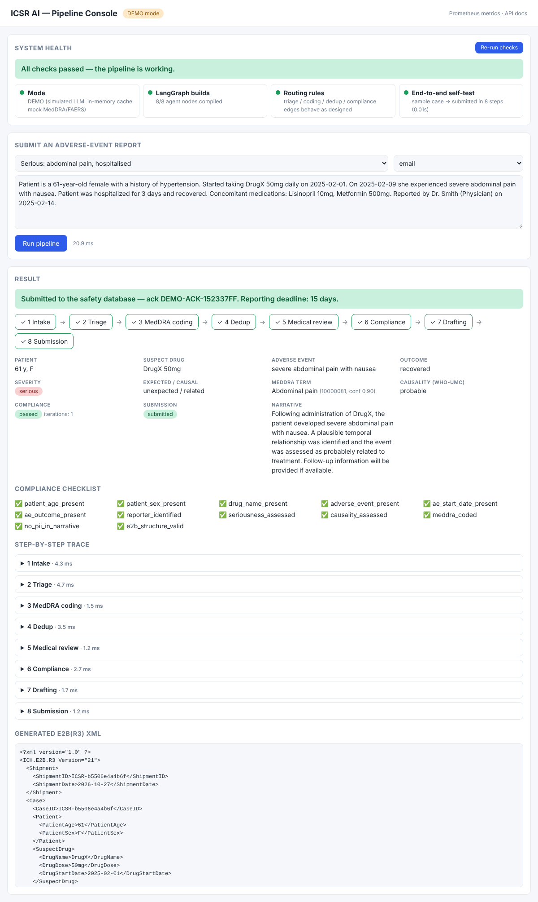

# icser-ai

**Autonomous Pharmacovigilance ICSR Case Processing** — a multi-agent AI pipeline that turns incoming adverse-event reports (Individual Case Safety Reports, ICSRs) into regulator-ready submissions.



*The local Pipeline Console (`python -m src.ui`) — health checks plus a step-by-step trace of a sample case.*

## Project Details

| | |
|---|---|
| **Domain** | Pharmacovigilance / drug safety (GxP-regulated) |
| **Language** | Python 3.11+ |
| **Orchestration** | LangGraph state machine (8 agent nodes, conditional + cyclic edges) |
| **LLMs** | Azure AI Foundry — GPT-4o (complex steps), GPT-4o-mini (simple steps), text-embedding-3-large |
| **Messaging** | Azure Event Hubs (`icser-reports` topic) |
| **RAG** | MedDRA index, duplicate-case index (FAISS, BM25, cross-encoder reranker) |
| **Observability** | Langfuse, Prometheus, Grafana (AI quality, cost budget, operations dashboards) |
| **Storage / cache** | PostgreSQL, ClickHouse, Redis, Azure Blob |
| **Deployment** | Docker, Kubernetes (Helm, HPA, CronJobs for eval/index), Terraform (Azure), Azure DevOps |

### How it works

1. **Ingestion** (`src/ingestion/`) – Event Hubs consumer plus parsers for PDF, email, HL7 v2.5.1, JSON and social media; output is a normalized `ICSRState`.
2. **Agent pipeline** (`src/agents/`, wired in `src/graph/`):
   1. **Intake** – extracts structured fields from the raw report
   2. **Triage** – decides whether the case is reportable and how urgent it is
   3. **MedDRA coding** – codes events to MedDRA terms using RAG
   4. **Dedup** – detects duplicate cases
   5. **Medical review** – clinical assessment (causality, seriousness)
   6. **Compliance** – checklist validation; on failure loops back to coding (max `MAX_COMPLIANCE_ITERATIONS`)
   7. **Drafting** – writes the case narrative
   8. **Submission** – generates E2B(R3) XML and submits to FAERS (`src/submission/`)
3. **Evaluation** (`src/evaluation/`) – golden set, LLM-as-judge, batch eval and a regression gate for CI.
4. **Safety & routing** (`src/llm/`) – model router, prompts, PII/safety guards.

### Repository layout

```
src/
  agents/          one module per pipeline agent + BaseAgent
  graph/           LangGraph builder and routing edges
  ingestion/       Event Hubs consumer, normalizer, parsers
  llm/             model router, prompts, safety
  rag/             vector store, MedDRA/dedup indexes, reranker
  submission/      E2B XML generator, FAERS client
  evaluation/      golden set, judge, batch eval, regression gate
  observability/   Langfuse, metrics, Prometheus exporter
  utils/           logging, Redis cache
  tests/           pytest suite
docker/            Dockerfile, docker-compose
k8s/               Helm chart (staging/prod values) and namespace
terraform/         Azure infrastructure
grafana/           dashboards
```

### Configuration

Copy `.env.example` to `.env` and fill in Azure, Foundry, Langfuse, database and threshold settings (e.g. `MEDDRA_CONFIDENCE_THRESHOLD`, `DEDUP_SIMILARITY_THRESHOLD`, `COST_BUDGET_MONTHLY_USD`).

### Quick start — local demo UI (no Azure needed)

```bash
python -m venv .venv && source .venv/bin/activate
pip install langgraph langchain-openai langfuse pydantic-settings structlog httpx \
    prometheus-client redis grpcio grpcio-health-checking fastapi uvicorn \
    beautifulsoup4 lxml azure-eventhub pytest pytest-asyncio respx
python -m src.ui            # → http://127.0.0.1:8080   (DEMO_MODE is on by default)
```

The **Pipeline Console** shows:

- **System health** — graph compiles (8/8 agents), routing rules, and an end-to-end self-test. A green banner means the pipeline works.
- **Run a report** — pick one of five sample reports (serious, non-serious, duplicate, incomplete, fatal) or paste your own, then see each agent's step, the MedDRA code, causality, compliance checklist, the generated E2B(R3) XML and the (mock) submission ack.
- `/metrics` (Prometheus) and `/docs` (OpenAPI) on the same port.

`DEMO_MODE=true` swaps the external dependencies for local stand-ins: a rule-based fake LLM (`src/demo/fake_llm.py`), a small in-memory MedDRA subset and prior-case list (`src/demo/data.py`), an in-memory cache instead of Redis, and a mock FAERS client. The agents, LangGraph wiring, routing, compliance loop and XML generation are the real code.

Sample scenarios and what to expect:

| Sample | Expected outcome |
|---|---|
| Serious: abdominal pain | all 8 steps, submitted, 15-day deadline |
| Non-serious: muscle pain | all 8 steps, submitted, 90-day deadline |
| Duplicate | stops after Dedup, nothing submitted |
| Incomplete | compliance fails and loops back to coding 3×, flagged for manual review |
| Fatal: anaphylaxis | all 8 steps, submitted, 7-day deadline |

### Running for real (Azure)

```bash
pip install -r requirements.txt
cp .env.example .env        # fill in Foundry, Event Hubs, Azure Search, Redis, Langfuse ...
python -m src.main          # gRPC health (:50051) + Event Hubs consumer + Prometheus (:8000)
DEMO_MODE=false python -m src.ui   # same console; health panel checks the live services
```

### Tests

```bash
pytest          # 13 tests, run entirely in demo mode
```

### Status

- Pipeline, routing, compliance loop, E2B XML generation and the UI run end to end in demo mode and are covered by tests.
- Live mode (real Azure Foundry / Event Hubs / Azure Search / FAERS) has **not** been exercised: it needs real credentials and indices (`meddra_terms`, `prior_cases`), and the FAERS endpoint in `src/submission/faers_client.py` is a placeholder.
- Not implemented / still stubs: HL7, JSON and social-media parsers are not wired into intake; evaluation modules expect `/data/eval/golden_set.json`; `azure-pipelines.yml` is empty.

### Further reading

The full architecture and design write-up (end-to-end diagrams, Langfuse observability, evaluation, cost controls, CI/CD, GxP notes) is in [`docs/DESIGN.md`](docs/DESIGN.md).
